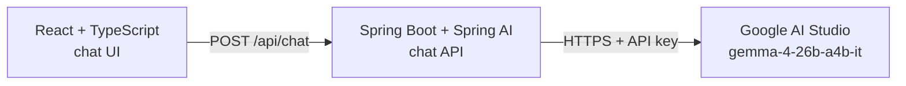

# PRD: Caramel AI Tech Support Chat Assistant

**Status:** Draft v0.1 · **Date:** 2026-10-31

## 1. Objective

Build a customer service chat assistant that answers technical support questions about LLM inferencing for Caramel AI, an LLM inferencing company similar to OpenRouter.

## 2. Users

- **Primary:** Caramel AI customers (developers and ML engineers) with questions about using our LLM inferencing service.
- **Secondary:** Caramel AI support staff, who receive the questions the assistant cannot resolve.

## 3. Goals

- Resolve common inferencing support questions instantly, at any hour.
- Reduce the number of routine tickets that reach human support.
- Keep answers on-topic and accurate for Caramel AI's services.

## 4. Scope

**In scope (v1)**
- Web chat UI in React + TypeScript
- Backend chat API in Java + Spring Boot using Spring AI
- LLM replies from `gemma-4-26b-a4b-it` served by Google AI Studio
- Multi-turn conversation within a single browser session
- Hand-off message pointing users to human support when the assistant cannot help

**Out of scope (v1)**
- Login, account lookup, or per-customer data
- Billing changes, refunds, or account management
- Chat history saved across sessions
- Admin dashboard or analytics
- Voice or image input

## 5. Functional Requirements

| ID | Requirement | Priority |
|----|-------------|----------|
| FR-1 | User can type a message and receive a reply in the chat window | P0 |
| FR-2 | Assistant remembers earlier messages in the same conversation | P0 |
| FR-3 | Assistant answers only inferencing-related support questions and politely declines others | P0 |
| FR-4 | When it cannot resolve an issue, the assistant tells the user how to reach human support | P0 |
| FR-5 | UI shows a loading indicator while waiting and a clear message on errors | P0 |
| FR-6 | Replies stream to the UI as they are generated | P1 |
| FR-7 | User can start a new chat, which clears the current conversation | P1 |

## 6. Non-Functional Requirements

- **Security:** The Google AI Studio API key is read from `.env` by the backend only. It is never sent to the browser and never committed to git.
- **Reliability:** If Google AI Studio is unavailable or rate-limited, the backend returns a friendly error instead of failing silently.
- **Cost control:** Conversation history is capped at a fixed number of recent messages to keep requests small.
- **Latency:** Response-time targets are defined during testing.

## 7. Architecture



**Backend components**
- `POST /api/chat` accepts `{ "sessionId": "...", "message": "..." }` and returns `{ "reply": "..." }`.
- Spring AI `ChatClient` sends the request to Gemma with a system prompt that defines the Caramel AI support role and scope.
- Spring AI chat memory (message window) keeps the last N messages for each `sessionId`.

## 8. Tech Stack

| Layer | Choice |
|-------|--------|
| Frontend | React, TypeScript |
| Backend | Java, Spring Boot, Spring AI |
| LLM | `gemma-4-26b-a4b-it` |
| LLM provider | Google AI Studio |
| Secrets | `.env` file holding the Google AI Studio API key |

## 9. Configuration

`.env` (never committed):

```
GOOGLE_AI_API_KEY=<your-api-key>
```

Add `.env` to `.gitignore`.

## 10. Success Criteria

- Correct answers on an agreed test set of inferencing questions (set size and pass rate to be defined).
- Human-escalation rate for routine questions decreases over time.
- No API key appears in the frontend bundle or in git history.

## 11. Milestones

1. **Backend spike:** Spring Boot app calls `gemma-4-26b-a4b-it` through Spring AI using the key from `.env`.
2. **Chat API:** `/api/chat` with session memory and the scoped system prompt.
3. **Frontend:** React chat UI wired to the API, with loading and error states.
4. **Hardening:** Streaming, new-chat action, tests, and review of the test question set.

## 12. Open Questions

1. Which support topics must v1 cover (for example API errors, rate limits, model availability, SDK setup)?
2. What is the human escalation path: email, ticket link, or live agent?
3. What tone and brand voice should the assistant use?
4. What Google AI Studio rate limits or quotas apply to `gemma-4-26b-a4b-it`, and how should we plan around them?
